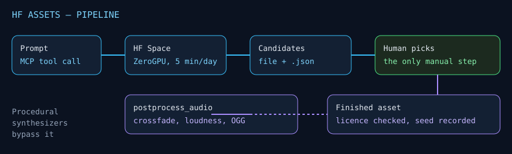

# HF Assets



An **MCP server** that generates game assets through **free** Hugging Face Spaces
— no GPU and no subscription: images, 3D meshes, sound and music. A free
Hugging Face token is optional and raises the daily quota.
Plus procedural synthesizers that spend no quota at all.

The ZeroGPU quota is shared by all Spaces and resets 24 hours after first use,
so the cheap option goes first and the expensive one is only run for the final
take.

## Install

```bash
npm install
npm run build
```

Node 20 or newer. The only runtime dependencies are the official MCP SDK, the
official Gradio JavaScript client and Zod.

## Run it as an MCP server

```bash
node dist/server.js
```

Register it with a client. Claude Code, for example:

```bash
claude mcp add hf-assets -- node /path/to/hf-assets/dist/server.js
```

or, for a client that reads a config file:

```json
{
  "mcpServers": {
    "hf-assets": {
      "command": "node",
      "args": ["/path/to/hf-assets/dist/server.js"],
      "env": { "HF_TOKEN": "hf_...", "HF_ASSETS_ROOT": "/path/to/hf-assets" }
    }
  }
}
```

This repository ships a [`.mcp.json`](.mcp.json) that points at the server next
to it, so a client that reads it needs no configuration at all.

| Variable | Meaning |
| --- | --- |
| `HF_TOKEN` | Free Hugging Face token (Read). A token raises the ZeroGPU quota. It is also read from a `.env` next to the server. Never commit it. |
| `HF_ASSETS_ROOT` | The directory relative paths are resolved against. Defaults to the working directory. |
| `HF_ASSETS_BLENDER` | Path to the Blender executable, for `render_mesh`. Found automatically in the usual install locations otherwise. |
| `FFMPEG_PATH` | Path to ffmpeg, for reading and writing OGG, MP3 and FLAC. Found on `PATH` otherwise. |

## The tools

| Tool | What it does |
| --- | --- |
| `list_models` | Every model with its Space, licence and cost. Read this first: it says which models may ship and which are prototype-only. |
| `generate_image` | Text → image. Z-Image Turbo, FLUX.2 Klein (edit from a reference), Qwen-Image (legible text in frame). |
| `generate_mesh` | Image → raw 3D mesh (GLB). Hunyuan3D-2, TRELLIS. |
| `generate_audio` | Text → sound, music or speech. Stable Audio Open, MMAudio, ACE-Step, Chatterbox. |
| `generate_audio_batch` | A whole manifest of audio assets, two takes each. The manifest is a file or JSON text. |
| `postprocess_audio` | Trim the silence, crossfade the ends into a seamless loop, normalise the level. |
| `synth_sound` | Procedural engine loop (any cylinder count), vehicle Foley (crash, tyre skid, boost) and music. No network, no quota. |
| `model_sheet` | A 4-in-1 model sheet prompt (front, rear, side, 3/4) for any object, from a note or from fields. Has a `vehicle` preset. |
| `render_mesh` | Six studio renders of a mesh, in Blender. |

`render_mesh` takes a couple of minutes on CPU: the client needs a longer
timeout than the default for that call. Lower `samples`, `width` and `height`
for a quick look.

## The resources

| URI | What it holds |
| --- | --- |
| `hf-assets://prompt-templates` | Prompt templates for model sheets, concept art and prop sheets. |
| `hf-assets://model-catalogue` | Every model with its Space, licence and cost, as JSON. |
| `hf-assets://audio-manifest` | An example audio manifest, showing the format the batch tool expects. |

## How it is put together

```
src/
  server.ts        the MCP server: every tool and resource
  catalogue.ts     the models: Space, licence, cost (the one source of truth)
  paths.ts         the working root and the package root
  types.ts         what the tools hand back
  gradio.ts        the Hugging Face Space layer, and the take/sidecar writer
  image.ts         text -> image
  mesh.ts          image -> mesh
  audio.ts         text -> sound, music, speech
  audio-batch.ts   a manifest of audio assets
  model-sheet.ts   the model sheet prompt builder
  render.ts        the Blender subprocess
  dsp/
    fft.ts         a complex FFT for any length
    engine.ts      the engine loop
    sfx.ts         vehicle Foley
    music.ts       the breakbeat suite
    postprocess.ts trimming, looping, normalising
    arrays.ts      the numpy-shaped array helpers
    rng.ts         a seeded random generator
    wav.ts         WAV natively, the rest through ffmpeg
blender/
  render_raw.py    the Blender mesh renderer
  studio_render.py the lights, the backdrop and the camera
```

`blender/` is the one part that is still Python: Blender's API is Python, so
the studio renderer is a script the server runs as a subprocess.

## Why this works

**A synthesised loop survives a pitch shift.** A recorded or generated loop has
an arbitrary length, so when the revs of an engine or a motor change in-game the seam produces a
phase jump — a click on every revolution. The synthesis is built so that the loop
contains a **whole number** of engine cycles and the seam matches in phase at
any pitch. The `synth_sound` tool checks this and reports:

```
seam step 0.0123 vs sharpest in-loop step 0.0254 -> looping is clean
```

**Selection stays human.** The pipeline is split on purpose: generation is
automatic, choosing the take is not. Candidates sit next to their prompt,
parameters and raw Space response (`*.json`), a human listens, picks one, and
only then does `postprocess_audio` turn the chosen take into a finished file.

**Every run is traceable.** Next to the result sits a `.json` with the prompt,
the parameters, the seed and the Space response, so a take can be repeated. The
one exception is Stable Audio Open: its Space takes no seed, so its takes are
numbered but cannot be reproduced exactly.

## ZeroGPU quota

| Account | GPU time per day |
| --- | --- |
| no token | ~2–3 min, about 3 runs in total |
| free, with `HF_TOKEN` | 5 min |
| PRO ($9/mo) | 40 min, above the limit is charged |

- The quota is shared between images, meshes and sound.
- It resets 24 hours after first use, not at midnight.
- A Space reserves time before it starts: if there is less than the reservation
  left, the run is rejected immediately, even if the computation itself would
  have taken seconds.

## Model licences

| Model | Licence |
| --- | --- |
| Z-Image Turbo, FLUX.2 Klein, Qwen-Image | Apache-2.0 |
| ACE-Step (music) | Apache-2.0 |
| Chatterbox (speech) | MIT |
| Stable Audio Open 1.0 | Stability AI Community (free below $1M revenue) |
| MMAudio | CC-BY-NC-4.0 — **not for production** |
| Hunyuan3D-2 | Tencent Hunyuan Community (with territorial restrictions) |
| TRELLIS | MIT |

Licences change: check the model page before using a model in a commercial
project. `list_models` carries the same table, and `generate_audio_batch`
refuses a manifest that names a non-commercial model. Prompts and images are
uploaded to Hugging Face.

## Prompt templates

Templates for model sheets, concept art and prop sheets live in
[PROMPT_TEMPLATES.md](PROMPT_TEMPLATES.md), also served as the
`hf-assets://prompt-templates` resource.

## Development

```bash
npm run dev        # run the server from the sources
npm run build      # the server tests run dist/server.js, so build first
npm test           # the test suite
npm run typecheck  # tsc --noEmit, sources and tests
```

The tests cover the FFT against reference values from numpy, the engine loop
against reference output of the original implementation, the post-processing
chain and the server itself over a real stdio pipe.

## Licence

MIT — see [LICENSE](LICENSE). It covers the code and the prompt templates.
The models behind the Spaces have their own licences, listed above.

Author: **Ivan Glazyrin** (<glazrus97@gmail.com>).
